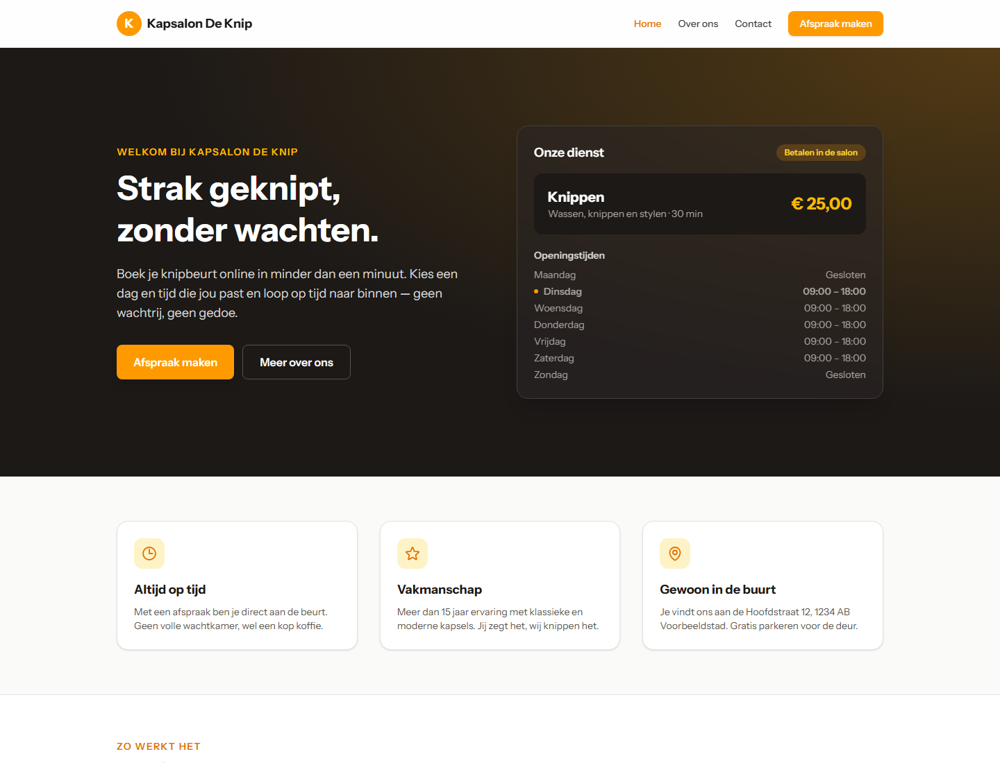
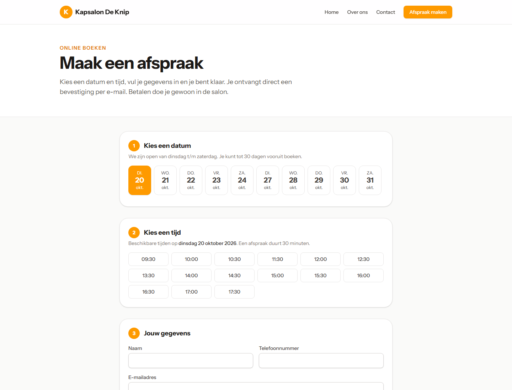
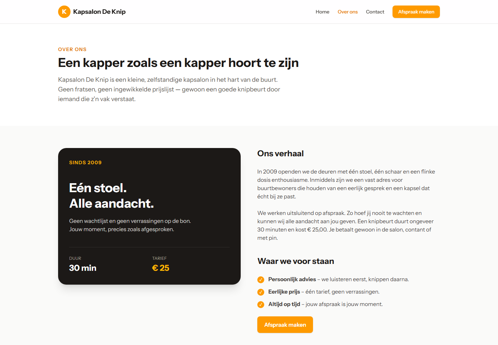

# Kapsalon De Knip

Website voor een kapsalon waar klanten online een knipafspraak maken. De kapper bevestigt, annuleert of herstelt die afspraken in een eigen dashboard.



## Functies

- Klanten kiezen een vrije dag en een tijdslot van 30 minuten, tot 30 dagen vooruit.
- Openingstijden, tarief en salongegevens staan in `config/salon.php`.
- Na het boeken krijgt de klant een bevestiging op het scherm en per e-mail.
- Het dashboard toont de agenda, openstaande aanvragen en de verwachte omzet van vandaag.
- Een contactformulier stuurt een bericht naar de salon.





## Techniek

Laravel 13, Livewire 4, Tailwind CSS 4, SQLite en PHPUnit. Lokaal gaat e-mail naar `storage/logs/laravel.log`.

## Installatie

```bash
composer setup
```

Zet daarna in `.env` een eigen beheerderswachtwoord van minimaal 12 tekens. Er is geen standaardwachtwoord.

```env
ADMIN_EMAIL=admin@kapsalondeknip.nl
ADMIN_PASSWORD=kies-zelf-een-lang-wachtwoord
```

```bash
php artisan db:seed
php artisan serve
```

De site staat op [http://127.0.0.1:8000](http://127.0.0.1:8000). Inloggen voor de kapper: `/admin/login`.

Voor frontend tijdens het ontwikkelen: `npm run dev`.

## Tests

```bash
composer test
```

GitHub Actions draait bij elke push en pull request `composer ci:check`: Pint en de testsuite.

## Beveiliging

- De bevestiging na het boeken hangt aan de sessie. Het afspraak-id is geen publieke Livewire-property, en het bevestigingstoken is vergrendeld.
- Een actieve boeking krijgt een unieke slot-sleutel. Twee aanvragen voor hetzelfde tijdstip kunnen niet allebei worden opgeslagen. Annuleren maakt het slot weer vrij.
- `/admin` vereist een ingelogde beheerder. Een gewoon account komt er niet in.
- Inloggen is beperkt tot vijf pogingen per minuut per e-mailadres en IP-adres.
